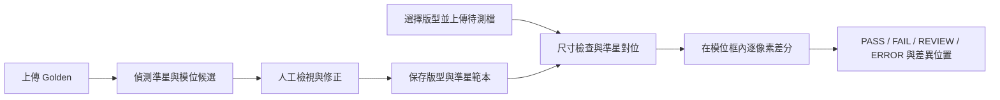
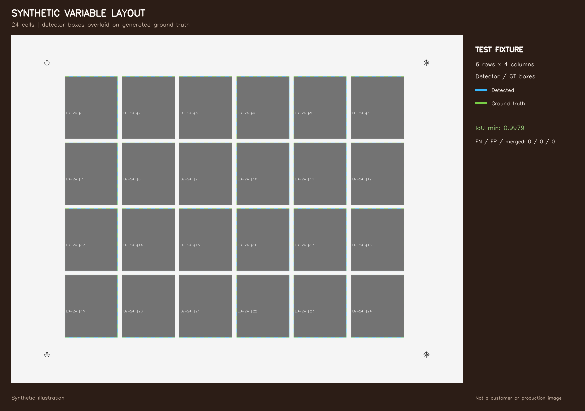
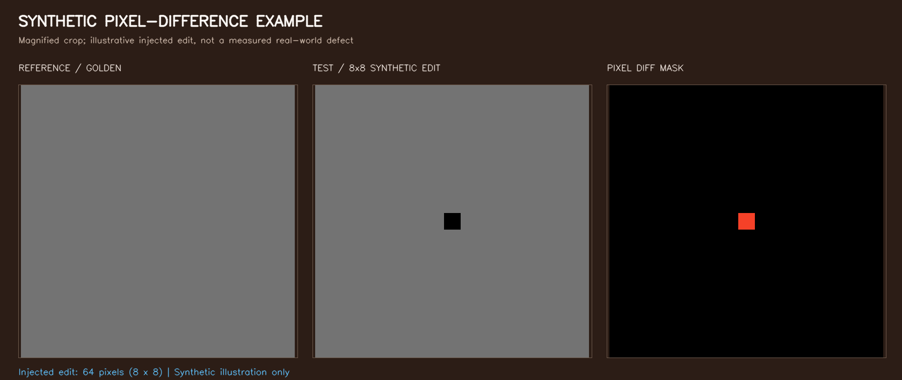

# 可變版型電子檔檢測原型

> 作品集案例初稿｜去識別化版本｜僅使用合成版型資料

> 授權狀態：此副本僅供公開展示，未附專案重用授權；第三方依賴另依各自授權。

## 摘要

我設計並迭代一個可變版型電子檔檢測原型。使用者可先建立版型、確認準星與模位，再以保存的 Golden 和模位座標檢查待測檔。系統不假設固定模數或單一尺寸網格，也不判讀文字語意；它在指定模位範圍內做像素差分並回報差異位置。

這個專案的重點不只是做出差分畫面，也包含驗證邊界：合成測試可檢查程式流程，但不能代替客戶檔案驗收；不同 JPG 輸出流程可能讓肉眼相似的檔案出現不同解碼像素。

## 問題與目標

固定版面檢測容易依賴預設模數、尺寸或網格。版面改成混款、缺格、密集或不規則排列時，若仍以固定規則切割，就可能漏抓或把非模位區域納入檢查。

原型要支援版型建置與後續檢測兩個階段：

1. 從電子版面提出準星與模位候選，讓人員檢查及修正後保存版型。
2. 檢測時載入對應 Golden，以準星對位，並只在已保存的模位框內計算差異。

## 系統流程

### 合成資料展示素材

以下圖片由專案內的合成測資可重現產生，僅用於說明流程，不是瀏覽器截圖，也不代表客戶或產線實測結果。

重建圖片：`python scripts/create_portfolio_visuals.py`。

### 主要設計

- **建版候選＋人工確認**：系統提供準星與模位候選及防呆提示；人員確認版型再保存，避免把自動偵測結果當成必然正確。
- **版型專屬對位**：版型保存準星座標與範本，檢測時依其定位。尺寸不符會拒絕比對；對位信心不足會進入 REVIEW，不輸出誤導性的 PASS/FAIL。
- **限定模位區域差分**：系統依保存的模位框統計差異，不把整張大版所有外圍區域都當成模位內容。
- **透明的差分判定**：目前正式流程採零容差像素差分；任何不相等像素會成為差異。系統標示位置，不分類缺墨、斷線或其他瑕疵種類。
- **設備狀態模擬**：後端將 PASS、REVIEW、ERROR 等結果傳給虛擬設備控制器；尚未連接實體 PLC。

## 技術與驗證

技術組合：Python、OpenCV、NumPy、SciPy，以及原生 HTML、CSS、JavaScript。版型偵測、影像對位、像素差分和前端 Canvas 編修分成獨立模組。

在去識別化副本中，完整單元測試共 **18 項，全部通過**。建版測試使用六種可重現合成版型，並以合成器產生的 Ground Truth 逐框配對：

| 合成案例 | 版型特徵 | 模位數 | 最低 IoU | 漏框 / 誤框 / 黏框 |
|---|---|---:|---:|---:|
| `layout_24_large` | 大尺寸、淺色底 | 24 | 0.9979 | 0 / 0 / 0 |
| `layout_60_mixed` | 方形與長條混合尺寸 | 60 | 0.9937 | 0 / 0 / 0 |
| `layout_40_missing` | 網格中預留空格 | 40 | 0.9956 | 0 / 0 / 0 |
| `layout_180_dense` | 高密度小模位 | 180 | 0.9909 | 0 / 0 / 0 |
| `layout_36_custom_fiducial` | 特殊準星、單角低對比 | 36 | 0.9956 | 0 / 0 / 0 |
| `layout_random` | 不規則排列、多尺寸及緊間距案例 | 45 | 0.9914 | 0 / 0 / 0 |

六種合成案例的最大框邊界誤差為 1 px。檢測測試另涵蓋尺寸不符攔截、Golden 自比、三個模位注入已知修改、整數像素平移，以及準星受損後轉 REVIEW 等情境。

### 對位的邊界測試

整數平移測試能以準星估計位移並恢復零差異。小數像素平移（+2.5、−1.3 px）與 0.15° 微旋轉則會因影像重採樣留下大量差異；在 `layout_24_large` 的合成觀察案例中，小數平移造成 362,448 個差異像素，微旋轉造成 617,393 個差異像素，24 個模位皆受到影響。這兩項是限制觀察，不是通過條件，也不代表所有影像的固定表現。

## 工程上的重要發現：像素相等不等於視覺相等

外部 JPG 經過重新編碼後，即使畫面看起來相同，解碼後仍可能有像素差異。零容差流程會把這些差異回報出來；因此，準星能成功對位，並不代表模位內容必然逐像素一致。

我也離線探索過由 Golden 建立局部容差的方法，並比較不同 JPEG 設定下的正常檔誤報與人工修改檢出。校準設定未能在所有留出壓縮條件下維持穩定，因此這條方法沒有併入正式 Demo。現有公開副本未包含該離線實驗的完整可重現資料，這裡不宣稱它已達通用或產線可用。

## 限制與下一步

- 測試版型是合成資料；此公開副本不含客戶檔或真實樣本，測試結果不能外推成客戶版型驗收。
- 自動建版屬候選偵測，仍需人員確認；未驗證任意底色、排版與輸出流程。
- 零容差比對適用於解碼像素一致的輸入；跨來源重存 JPG 的容差規則尚未定案。
- 目前沒有實體相機、PLC 或生產線測試。
- JPG 容差離線實驗不屬於此副本目前的產品功能，不能據此宣稱跨編碼或跨來源檢測可靠。

## 專案角色

需求範圍、驗收問題與測試方向由專案負責人定義，並使用 AI 協作工具迭代原型與測試。上架前請依實際分工補充或調整個人貢獻描述。

---

**公開素材說明：**此初稿只引用去識別化副本中的合成測試結果，不含客戶名稱、品牌圖樣或真實樣本圖片。
